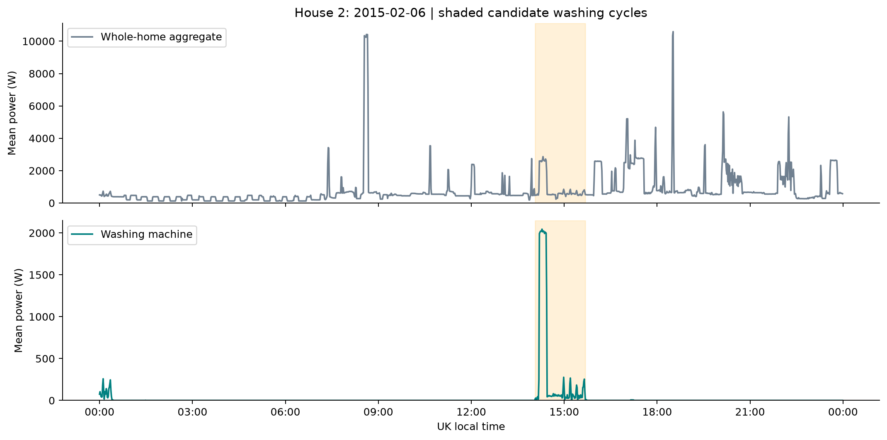
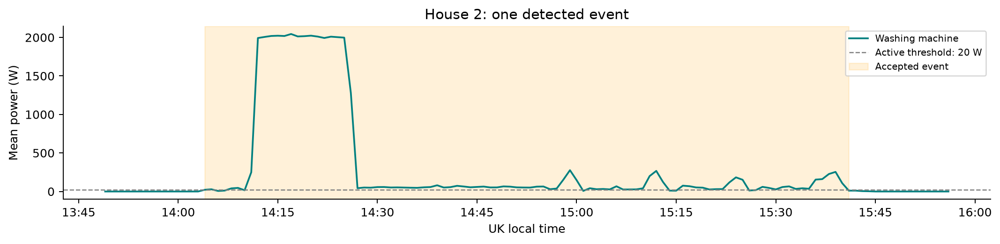
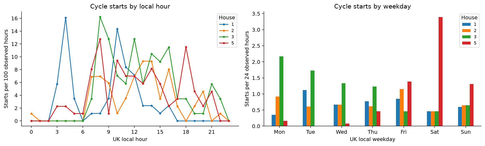
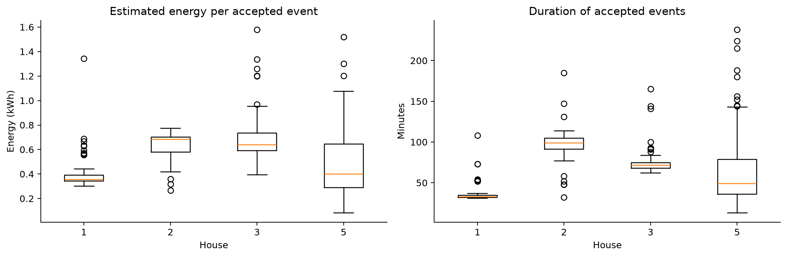
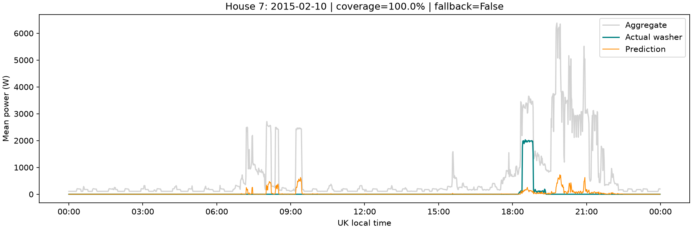
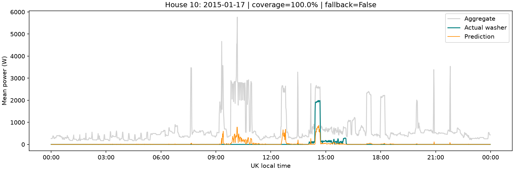
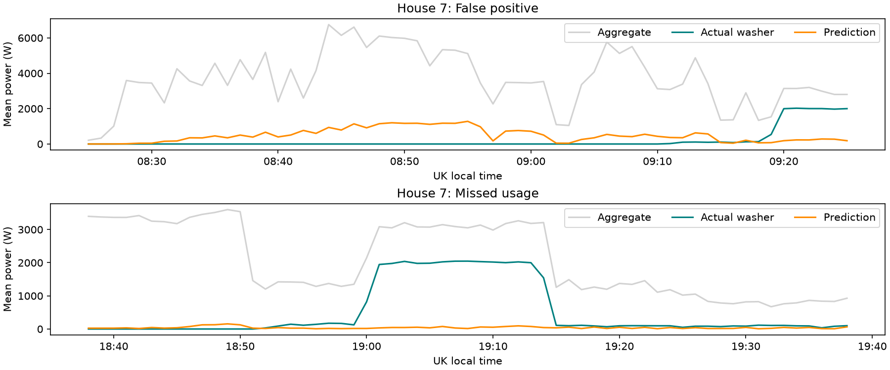
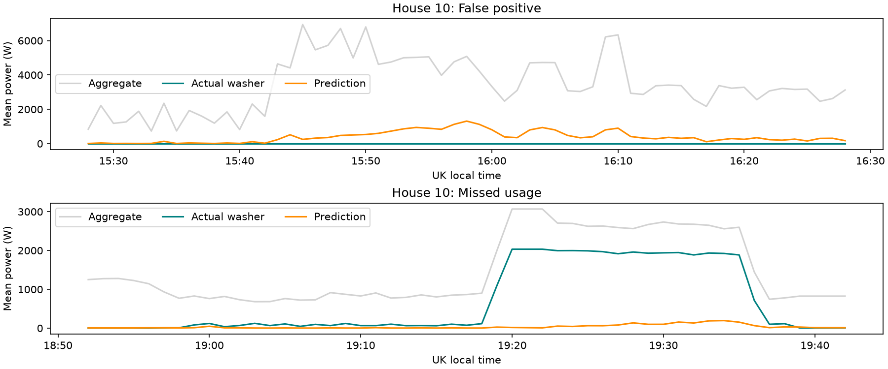
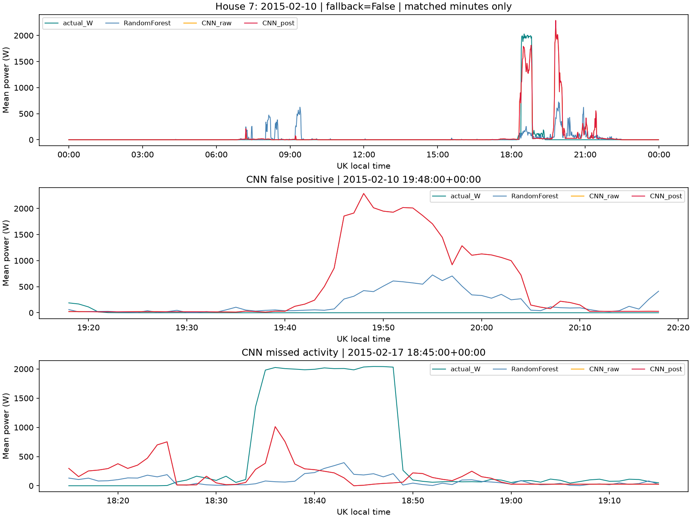
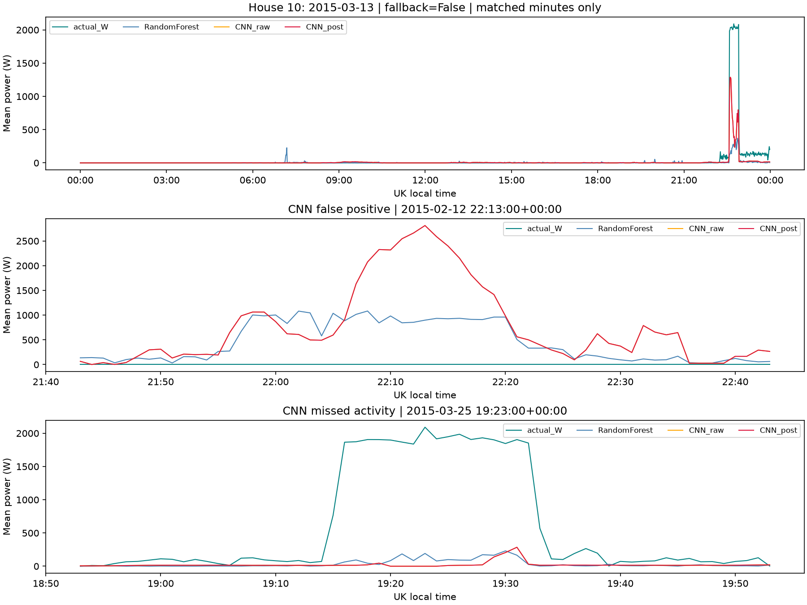

# Part 2 results: washing-machine use

Generated by `WashingMachine_Part2_EDA.ipynb`. This section contains Part 2 findings.

## Data and method
Official cleaned Houses 1, 2, 3 and 5, with washing-machine channels {1: 'Appliance5', 2: 'Appliance2', 3: 'Appliance6', 5: 'Appliance3'}. The common window is 2015-01-01 00:00:00+00:00 to 2015-04-01 00:00:00+00:00 exclusive (January-March 2015). Resampling uses UTC; behavioural charts use Europe/London time. The source-file audit records full file coverage, selected rows and issue-flagged minutes. Issue-flagged readings are retained, with per-event counts as permitted by the README; no new interpolation is used. Published forward filling limits interpretation of sensor availability.

| house | usable_percent | zero_percent_of_usable | low_off_percent_of_usable | missing_minutes | accepted_cycles | cycles_with_issue_flags | cycles_per_observed_week |
| --- | --- | --- | --- | --- | --- | --- | --- |
| 1 | 94.81 | 97.63 | 98.12 | 6724 | 59 | 59 | 4.84 |
| 2 | 96.2 | 94.5 | 95.13 | 4920 | 63 | 59 | 5.09 |
| 3 | 96.41 | 92.45 | 94.0 | 4648 | 98 | 97 | 7.91 |
| 5 | 96.34 | 75.73 | 90.36 | 4748 | 87 | 78 | 7.02 |

Zero/off percentages use only usable minute values. Low/off means <= 20 W, not confirmed switched-off time. Missing readings do not count as off. Rates per observed week adjust for exposure but not non-random missingness.

## Event rule
Active mean power > 20 W; join active minutes across at most 10 quiet minutes, never through missing data. Accept >= 5 active minutes, duration 10-240 minutes and peak >= 500 W. Require 11 observed minutes on both sides. These are candidate complete events, not labelled true cycles. Cold washes and long pauses can be missed or split; nearby cycles can merge.

Detected 307 accepted events. **293 events contain at least one REFIT issue-flagged minute**; the median event has 14.3% flagged minutes. The per-house median flagged percentage is reported below. These discrepancies reduce confidence in exact aggregate/submeter consistency and energy estimates; retaining them is an explicit exploratory choice, not a claim that the flags are resolved. Filtering every flagged minute fragmented most events in an initial diagnostic, so the final rule retains them with transparent flags as allowed by the README.

Energy is sum of minute power divided by 60,000, in kWh; duration includes short internal pauses and excludes unobserved/low-power tails. Peaks refer to minute means.

| house | cycles | median_duration_minutes | median_energy_kWh | median_peak_minute_W | median_issue_flagged_percent |
| --- | --- | --- | --- | --- | --- |
| 1 | 59 | 33.0 | 0.357 | 2314.1 | 20.588 |
| 2 | 63 | 99.0 | 0.685 | 2078.111 | 4.808 |
| 3 | 98 | 71.5 | 0.641 | 1930.056 | 16.18 |
| 5 | 87 | 49.0 | 0.402 | 2077.333 | 8.889 |

## Plots and interpretation

House 2, 2015-02-06, chosen from 24-hour local days with at least 95% joint coverage with a median-energy candidate event. Shading shows accepted events alongside aggregate demand; this day has 99.9% joint coverage and missing values remain blank. This is an illustrative day, not a random sample.

The selected event lasts 97 minutes and contains approximately 0.59 kWh. Boundaries depend on the active-power rule; no appliance programme labels are available.

Largest pooled exposure-adjusted start rates occur at 08:00 UK local time and on Saturday. Per-house curves show differences; pooled peaks need not describe every home. Hourly rates are starts per 100 observed clock-hours; weekday rates are starts per 24 observed hours on that weekday.

House 1 has the lowest detected median event energy and House 2 the highest in this period. Programme, load, machine and detection differences prevent an efficiency ranking.

## Validation and limitations
Passed: four homes, regular unique minute grids, issue-flag reporting, non-negative finite available values, reconciled availability, event counts and event energy/duration calculations. The synthetic pause/missing-data check passed. Exact event truth, cycle recall, programme/load characteristics and source sensor freshness remain unknown. Missingness and complete-event filtering can bias behaviour comparisons. The results cover one winter/early-spring quarter and four selected homes.

All event/candidate tables, exact missing-interval ranges, quality summaries and exposure denominators are in `outputs/part2/`. Rejected candidates include reasons. No Part 1 files are used or changed; no model is trained. Dataset attribution: REFIT, University of Strathclyde, with CC BY 4.0 per the supplied README. AI tools used across the project: OpenAI Codex, ChatGPT and the VS Code agent (Copilot SDK); numerical findings are from the executed notebook.

<!-- PART3_START -->

# Part 3: washing-machine disaggregation

Run `WashingMachine_Part3_Model.ipynb` with Jupyter Restart & Run All. It requires NumPy, pandas, Matplotlib, scikit-learn, joblib, threadpoolctl and Jupyter. Configure ROOT and the `clean/` and `outputs/part2/` paths in the notebook. It writes `results/evaluation_metrics.csv`, `results/washing_machine_model.joblib` and Part 3 figures; no separate execution script is needed. Part 2 exports for Houses 2/3/5 are reused when available; otherwise the same rules load official cleaned CSVs. Other selected homes are loaded from clean/.

Train Houses 2/3/8/9; validate 5; evaluate 7/10 separately. January 1 to April 1, 2015 (exclusive), UTC, one-minute mean active power in watts. Both evaluation homes have been inspected before and are retrospective; no test result selected a setting. Dedicated washer channels: 2/Appliance2, 3/Appliance6, 5/Appliance3, 7/Appliance5, 8/Appliance4, 9/Appliance3, 10/Appliance5. Separate washer-dryers are excluded.

Use 12 aggregate/calendar features with complete causal 61-minute history. Compare always-off, scaled Ridge, Random Forest and HGB on identical rows. Seven fits: three reference settings, one alternative per family and one HGB active-weight check. Select by validation F1 among models beating always-off on RMSE and daily energy error; a tuned setting needs a 0.01 F1 gain to replace its reference. The criterion was fixed before test loading. No weighted composite score is used.

### Measured conclusion

Random Forest (`RF_reference`: 60 trees, maximum depth 14, minimum leaf size 20) was selected on House 5: F1 **0.322**, RMSE **207.16 W**, daily energy error **89.7%**. Ridge alpha=100 and larger RF leaves did not justify replacing their references. HGB with 31 leaves scored F1 **0.306**; Random Forest remained selected. Weighting active minutes increased recall but failed the power/energy guards.

On House 7, the selected model has precision **40.8%**, recall **77.1%**, F1 **0.533** and MAE **49.05 W**. On House 10 these are **30.5%**, **71.2%**, **0.427** and **42.48 W**. Daily energy error remains **40.9% / 75.7%**. Always-off has lower MAE on both homes but detects no activity; the selected model reduces RMSE and daily energy error. Neither result establishes reliable appliance accounting.

The examples show underestimated high-power washer phases, false washer attribution during other aggregate activity, and missed active phases. These are observed error patterns; the responsible competing appliance cannot be established from these plots. The new compact-feature, Part 2-consistent analysis uses a different eligible population from earlier raw-screened experiments, so its metrics are **not directly comparable improvements** over those reports.

## Model comparison

| split | model | MAE_W | RMSE_W | precision | recall | F1 | energy_bias_percent | daily_energy_error_percent |
| --- | --- | --- | --- | --- | --- | --- | --- | --- |
| validation | AlwaysOff | 38.713 | 218.377 | 0.0 | 0.0 | 0.0 | -100.0 | 100.0 |
| validation | Ridge | 61.584 | 207.303 | 0.174 | 0.772 | 0.283 | -8.979 | 98.022 |
| validation | RandomForest | 50.786 | 207.16 | 0.269 | 0.401 | 0.322 | -39.612 | 89.714 |
| validation | HGB | 51.187 | 210.881 | 0.269 | 0.328 | 0.296 | -39.314 | 90.82 |
| test_house7 | AlwaysOff | 41.418 | 261.39 | 0.0 | 0.0 | 0.0 | -100.0 | 100.0 |
| test_house7 | Ridge | 52.39 | 233.755 | 0.273 | 0.708 | 0.394 | -38.038 | 46.178 |
| test_house7 | RandomForest | 49.051 | 219.49 | 0.408 | 0.771 | 0.533 | -28.286 | 40.913 |
| test_house7 | HGB | 49.881 | 218.693 | 0.377 | 0.59 | 0.46 | -27.712 | 40.782 |
| test_house10 | AlwaysOff | 27.481 | 195.309 | 0.0 | 0.0 | 0.0 | -100.0 | 100.0 |
| test_house10 | Ridge | 49.752 | 177.46 | 0.123 | 0.557 | 0.201 | 21.307 | 88.548 |
| test_house10 | RandomForest | 42.479 | 172.791 | 0.305 | 0.712 | 0.427 | 19.427 | 75.677 |
| test_house10 | HGB | 43.316 | 175.887 | 0.283 | 0.542 | 0.372 | 19.192 | 75.553 |

Activity metrics use >20 W and describe minutes, not whole cycles. Energy is sum(W)/60,000 kWh. Daily error sums absolute UK-local daily differences over measured energy, using identical eligible minutes; net bias may cancel errors. Partial days remain partial observations. The complete tuning table, coverage, Issues strata and failure counts remain in notebook outputs.

## Data quality and coverage

Follow Part 2: sort/deduplicate Unix timestamps, mask impossible readings, retain Issues flags with disclosure, average to minutes, and do not interpolate. Cleaned zeros/filled readings are not independently verified sensor states. This simpler analysis avoids adding aggressive raw-support exclusions; that source uncertainty remains. Feature eligibility leaves 121,077 validation minutes, 123,373 House 7 minutes and 119,868 House 10 minutes (93.4%, 95.2%, 92.5% of the configured grid). Results and energy totals cover only eligible minutes. The fixed split, small household sample, reused validation/evaluation homes and single quarter limit generalisation. UK-to-India deployment needs local validation.

## Figures

The selected day is closest to median active-day energy among well-covered days. It illustrates behaviour after evaluation; it does not determine the model.

These worst-error windows show false attribution and missed usage. False-active minutes are 11,541 / 14,023 and missed active minutes are 2,358 / 2,492 for Houses 7 / 10. Appliance identity behind interference is unverified.

## Verification and scope

Fresh-kernel sequential execution passed all 10 code cells. Checked regular grids, source values/flags, household separation, causal and missing-history features, prediction bounds, daily-energy cancellation and CSV round-trip. Part 1 and Part 2 notebooks/reports were unchanged. The first Part 3 notebook exports model metrics, four figures and the selected Random Forest bundle (`results/washing_machine_model.joblib`). No runner, hashing framework, JSON manifest or generated prediction files are required. Sensor truth, cycle recall, prospective household accuracy and billing accuracy remain unverified.

Sources: supplied assignment, cleaned REFIT README and Part 2; [official cleaned REFIT](https://pureportal.strath.ac.uk/en/datasets/refit-electrical-load-measurements-cleaned/). REFIT attribution: University of Strathclyde, CC BY 4.0. AI tools used across the project: OpenAI Codex, ChatGPT and the VS Code agent (Copilot SDK). All metrics above are computed results. Part 4 is outside this notebook.

## Part 3B — Seq2Point CNN: second modelling notebook

`WashingMachine_Part3_Seq2Point.ipynb` is the second Part 3 modelling notebook. It trains and evaluates a 99-minute centred-window CNN against the saved Random Forest on **identical eligible minutes**. It uses the same training households (2, 3, 8, 9), validation House 5 and retrospective evaluation Houses 7 and 10. The CNN sees **49 future minutes**, so its inference is offline; it is not directly equivalent to a real-time causal Random Forest. The reported values below are **paired-cohort** results and must not be confused with the full-coverage Random Forest table above.

| Household | RF F1 | CNN F1 | RF false-positive minutes | CNN false-positive minutes | RF RMSE (W) | CNN RMSE (W) |
| --- | ---: | ---: | ---: | ---: | ---: | ---: |
| 5 — validation | **0.319** | 0.281 | 12,155 | **4,332** | 205.58 | **202.24** |
| 7 — retrospective | 0.534 | **0.645** | 11,445 | **7,289** | 220.00 | **161.47** |
| 10 — retrospective | 0.428 | **0.557** | 13,885 | **6,860** | 172.28 | **157.02** |

CNN improved activity F1 and reduced false-positive minutes on Houses 7 and 10, but **lost validation F1 and recall on House 5**. It therefore did **not** replace the validation-selected Random Forest. Temporal state-machine filtering was tested on House 5, but its chosen settings were `(max_gap=0, min_duration=0)`—no actual filtering benefit. Daily energy error remained high (CNN: 35.3% House 7, 66.2% House 10); these are not billing-grade estimates. The two evaluation homes had been examined previously and are not blind prospective tests. The experiment used the original fixed household split; the later exploratory leave-one-house-out notebook is **not part of this final version**.

Detailed comparison results are in the Seq2Point notebook and `results/seq2point_comparison.csv`. The CNN architecture is inspired by Zhang et al. (2018); this implementation and evaluation are specific to the assignment.

## Research references

- Murray et al. (2017), *An electrical load measurements dataset of United Kingdom households from a two-year longitudinal study*, Scientific Data. https://doi.org/10.1038/sdata.2016.122
- [University of Strathclyde REFIT cleaned release](https://pureportal.strath.ac.uk/en/datasets/refit-electrical-load-measurements-cleaned/) (dataset DOI: 10.15129/9ab14b0e-19ac-4279-938f-27f643078cec).
- Zhang, Zhong, Wang, Goddard & Sutton (2018), *Sequence-to-Point Learning With Neural Networks for Non-Intrusive Load Monitoring*, AAAI. https://doi.org/10.1609/aaai.v32i1.11873

**AI tools used across the project:** OpenAI Codex, ChatGPT and the VS Code agent (Copilot SDK) assisted with development, review and documentation. Decisions, limitations and numerical outputs are presented for independent scrutiny; no savings or deployment performance was measured.
